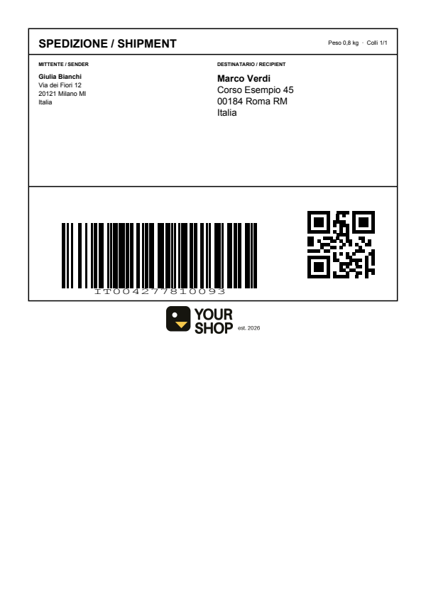
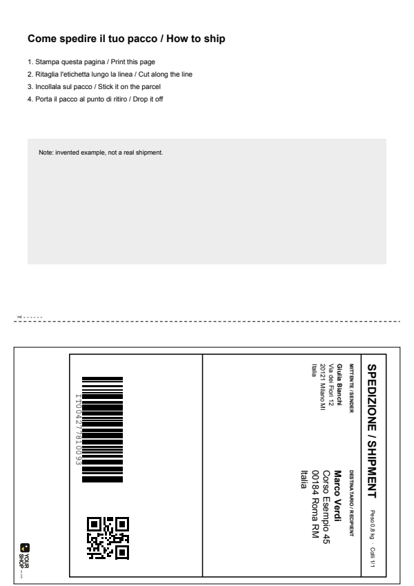
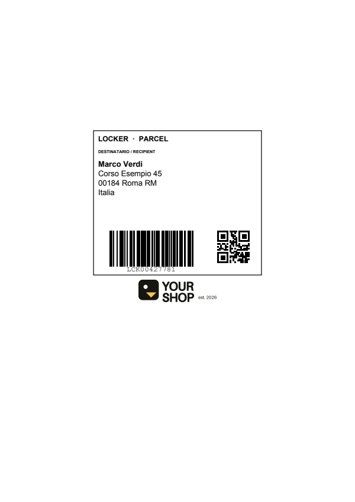

# brand-my-label

Put your shop logo on shipping labels, wherever it fits.

Drop a label PDF from Vinted, Poste Italiane, InPost, BRT, DPD (or the Vinted
label viewer page) plus your logo, and get a print-ready PDF back.

**Try it: https://labels.sim1.org** (Italian / English)

| Label on top | Cut-out strip | A6 |
|---|---|---|
|  |  |  |

<sub>Example labels are synthetic (invented names and addresses); regenerate with
`python examples/make_examples.py`.</sub>

| Label layout | Example | What happens |
|---|---|---|
| Label on top, white space below | Poste, DPD (A4) | logo centred under the label |
| Compact page | InPost (A6) | page re-centred on A4, logo in the free space |
| Cut-out strip at the bottom | BRT / Vinted (A4) | small logo **inside** the strip, rotated like its text, so it survives the scissors |
| Full page | — | returned unchanged, no logo |

No per-courier settings: placement comes from the page layout (free space under
the content, with a filter for invisible full-page clip paths; otherwise a
bordered strip in the lower half; otherwise skip). Already-branded PDFs are
detected and returned as is.

## Use it

- **Web:** the demo site (GitHub Pages) calls the API on Google Cloud Run.
- **CLI:**
  ```bash
  pip install .
  brand-my-label label.pdf logo.png            # -> label-branded.pdf
  brand-my-label label.pdf logo.png --keep-size # don't re-centre A6 on A4
  ```
- **Library:**
  ```python
  from brand_my_label import stamp_pdf
  result = stamp_pdf(pdf_bytes, logo_bytes)
  result.pdf, result.mode, result.placed
  ```

## Privacy

Labels contain buyer names and addresses. The API processes them in memory and
never writes or logs them. Analytics (PostHog, EU) records only layout metadata
(placement mode, courier guess, page count, timing). The site sets no cookies
and never records sessions. Your logo is kept in your browser's local storage
so you don't have to pick it again.

## Run locally

```bash
uv venv && uv pip install -e ".[server,dev]"
pytest
POSTHOG_DISABLED=1 uvicorn server.main:app --port 8091   # API
python -m http.server 8000 -d docs                         # site
```

## Layout

```
brand_my_label/  stamping core (pure, bytes in/bytes out) + Vinted HTML fetcher + CLI
server/          FastAPI app for Cloud Run (limits, rate limit, CORS, analytics)
docs/            static site for GitHub Pages
tests/           synthetic labels only, never commit real ones
```

See [DEPLOY.md](DEPLOY.md) for Cloud Run and GitHub Pages.

## License

MIT
